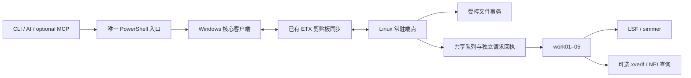

# 架构与边界

协议签名、加密、长度、摘要及剪贴板生命周期只在核心模块中维护。批量薄入口复用外层进程，仍逐项调用核心；部分成功有独立回执，不把整批假定为一次原子提交。

Windows 私钥留在本机，Linux 私钥留在 Linux。首次引导只传公共源码、路径设置和客户端公钥；服务器指纹经已登录 ETX 终端确认。两端不经聊天传密码、Token 或私钥。

文件服务只使用私有配置的明确范围；Worker 是当前用户前台进程，继承自己配置的工程/EDA 环境。角色与文件范围是工作流边界，不代表独立操作系统沙箱。

会话地址属于实际接收端点的绑定；安装目录名称不限制 Worker 节点。跨节点参与者需使用相同队列、代码和锁根，并验证所在文件系统的锁语义。

波形是受限任务适配，实际后端与商业库由使用者提供。数据保留在 Linux，返回有界信号/时间窗查询结果，不通过文件下载接口搬运整个 FSDB。

GitHub 存放公共源码、合成测试和配置示例，不承担当前运行时派单，不保存真实实例的身份和状态。
